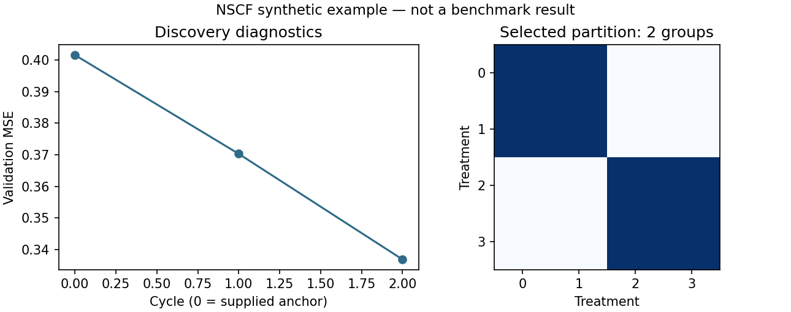

# NSCF-ITR · Method implementation

**Learning explicit treatment-sharing structure inside a neural outcome model.**

[Paper](https://arxiv.org/abs/2610.19104) · [Quick start](docs/QUICKSTART.md) · [API](docs/API.md) · [Method notes](docs/METHOD.md) · [Validation](docs/VALIDATION.md)

Implementation and maintenance: **Daixi Huang**.

This repository contains the NSCF method from *Neural Supervised Clustering for
Learning Individualized Treatment Rules with Many Treatments*. The research
paper is by **Daixi Huang, Yixin Yuan, Yifan Dai, and Yufeng Liu**.

NSCF combines neural Q-learning with fusion of treatment-specific embeddings.
It discovers candidate treatment partitions, refits under those partitions,
and selects a predictor using validation data. Treatments in the selected
group share a learned response function in this model.

## Scope

This is a **method-only implementation**, initialized with a fresh Git history.
The repository is currently **private**; no open-source license is granted by
this packaging step.

Included:

- Shared neural outcome model and L1 fusion/discovery kernels.
- Exact coordinatewise isotonic Z update with the original row-snapping rule.
- Grouped neural refitting and validation-based model selection.
- A scikit-learn-style estimator with automatic anchor training, treatment-label
  mapping, training-only standardization, and retained advanced anchor input.
- Runnable examples, interpretation tutorials, and software regression tests.

Not included: SCAF implementation, other benchmark implementations, raw PDX
data, saved research checkpoints, server logs, or the complete experimental
archive. This repository does not claim to reproduce all paper tables from
scratch. The full experiment archive remains separate and private.

## Install

Python 3.10 and CPU execution are recommended. Cloning this private repository
requires access.

```bash
git clone https://github.com/daisy6932/nscf_itr_method.git
cd nscf_itr_method
python -m venv .venv
source .venv/bin/activate
python -m pip install -r requirements.txt
python -m pip install --no-deps -e .
python -m unittest discover -s tests -v
```

No R installation, external dataset, or cluster account is needed. This private
development version is **not published on PyPI or TestPyPI**. Do not use
`pip install nscf-itr-method` expecting a public distribution.

## Quick start

```bash
python examples/quickstart.py
```

```python
from nscf import NSCF

# Short execution-check settings, not recommended research training budgets.
model = NSCF(
    hidden_layer_sizes=(16, 8), pretrain_epochs=20,
    max_cycles=1, num_lambdas=3, admm_epochs=3,
    theta_steps=2, refit_epochs=10, eval_every=5,
    random_state=42,
)
model.fit(X_train, y_train, treatment=A_train)
recommendations = model.predict(X_test)         # original treatment labels
outcomes = model.predict_outcomes(X_test)       # columns follow treatments_
print(model.treatments_, model.group_ids_)
```

`fit` makes an internal stratified validation split unless you supply
`validation_data=(X_val, y_val, A_val)`. Standardization is learned on the fitting
subset only. Use `outcome_direction="minimize"` when smaller outcomes are better;
predictions remain in the original outcome units. [Full tutorial](docs/QUICKSTART.md).

The interface supports sklearn parameter management and cloning. It is a
treatment-policy estimator, not a classifier of observed treatments: it has no
default accuracy/R2 `score`, and general `GridSearchCV`/metadata-routing support
is not claimed. [Explicit cross-validation example](examples/cross_validation.py).

## Advanced anchor example

```bash
python examples/synthetic.py --output runs/my_first_demo
```

Use a new output directory. The script generates synthetic train/validation/test
splits, fits preprocessing on training data, trains an unfused initialization,
and runs NSCF. It writes `summary.json` and `demo.png`. The independent test set
is evaluated only after model selection.



This is one small execution example, **not a paper benchmark or evidence of
superiority**. Its convenience anchor uses a fixed epoch cap; the full paper
archive has its own historical, compute-budget-matched anchor construction.
The included figure is the unselected output of the documented default example.

## Advanced: supply your own anchor

For exact control over the pretrained model, the original advanced entry point
is retained:

```python
from nscf import NSCF

# anchor: trained nscf.core.model.Net, with one embedding per treatment
# X: training-only standardized covariates; A: integer labels 0,...,K-1
# y: observed outcomes, with larger values preferred
model = NSCF(config={"global_seed": 123}).fit_from_anchor(
    anchor, X_train, A_train, y_train, X_val, A_val, y_val
)
recommended_treatment = model.predict_treatment(X_test)
predicted_outcomes = model.predict_outcomes(X_test)
print(model.group_ids_, model.diagnostics_)
```

Use `make_anchor` and `train_anchor` as in the advanced example to create a
standalone initialization. Both entry points accept **no test outcomes or known
treatment groups**. For `fit_from_anchor`, covariate preprocessing remains the
caller's responsibility; for ordinary `fit`, standardization is built in.
Both return the selected discovery model, with **no final restart/long refit**.

The generic interface does not implement the PDX-specific unfused treatment
mean offsets. That application pipeline remains in the full private archive.

## Repository map

| Location | Contents |
| --- | --- |
| `src/nscf/api.py` | Estimator, validation split, preprocessing, label mapping |
| `src/nscf/estimator.py` | Advanced discovery adapter and anchor helpers |
| `src/nscf/core/` | Neural network, fusion, grouped-refit, and selection kernels |
| `src/nscf/exact_prox.py` | Complete-graph coordinate L1 proximal operator |
| `src/nscf/defaults.json` | Retained discovery/training defaults |
| `examples/quickstart.py` | Self-contained ordinary-fit example |
| `examples/cross_validation.py` | Explicit fold-wise evaluation with treatment labels |
| `examples/synthetic.py` | Reproducible advanced-anchor demonstration |
| `tests/` | Interface, core-integrity, prediction, and regression checks |
| `.github/workflows/tests.yml` | Private repository tests/build; no publishing steps |
| `SOURCE_PROVENANCE.json` | File hashes and extraction provenance |

## Citation

Please cite the research paper for the method. Code-maintainer credit and paper
authorship are recorded separately in [AUTHORS.md](AUTHORS.md) and
[CITATION.cff](CITATION.cff).

```bibtex
@misc{huang2026neural,
  title = {Neural Supervised Clustering for Learning Individualized Treatment Rules with Many Treatments},
  author = {Huang, Daixi and Yuan, Yixin and Dai, Yifan and Liu, Yufeng},
  year = {2026},
  eprint = {2610.19104},
  archivePrefix = {arXiv},
  primaryClass = {stat.ML},
  url = {https://arxiv.org/abs/2610.19104}
}
```

## Limitations and permissions

The loss is nonconvex in the full neural parameters; an exact conditional Z
update is not a full-algorithm convergence guarantee. Hard sharing can be
harmful when within-group treatment effects differ. Prediction gains, partition
recovery, and clinical interchangeability are different claims. This code is
research software, not a validated clinical decision system.

Dependencies are installed separately under their own licenses. Attribution
and public-release considerations are in [NOTICE.md](NOTICE.md). No SCAF source
is distributed, and no permission to redistribute third-party implementations
is implied. Public release and software licensing remain separate decisions.
